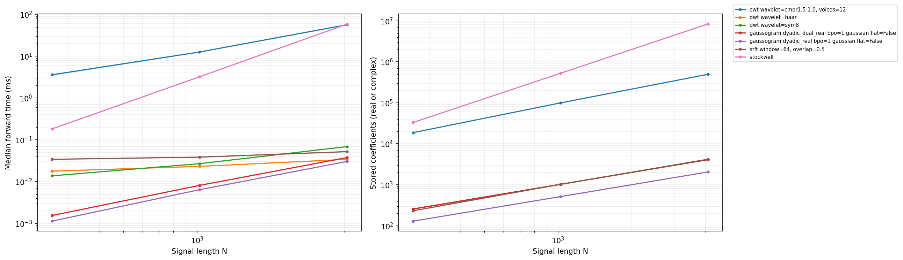
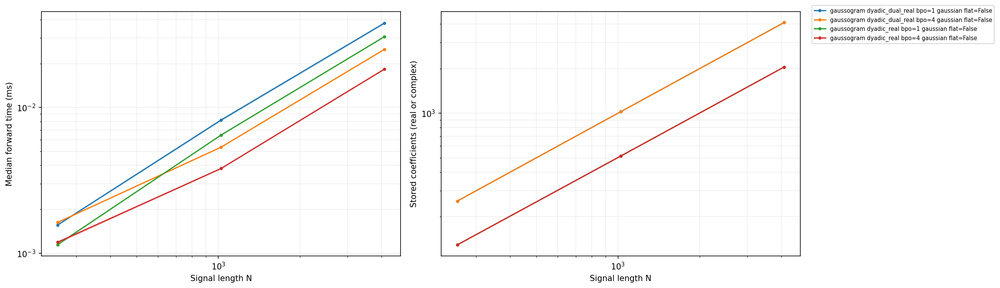

# Transform runtime benchmark

Run: 2026-10-24T16:39:04Z on macOS-26.6.2-arm64-arm-64bit-Mach-O; arm64.

Warm forward calls include Python overhead and output allocation. Setup and one-shot
timings are separate. Shading shows the interquartile range of batch-average timings.
Methods differ in resolution, boundary handling, precision and output size;
these are implementation comparisons, not equal-accuracy comparisons.

Full configuration, versions, warnings, thread settings, and raw samples: [results.json](results.json).
Machine-readable phase timings: [results.csv](results.csv).

| Method and settings | N | Forward ms | Setup ms | One-shot ms | Coefficients | Output MiB |
|---|---:|---:|---:|---:|---:|---:|
| gaussogram dyadic_real bpo=1 gaussian flat=False | 256 | 0.0011 | 0.0309 | 0.0330 | 129 | 0.002 |
| gaussogram dyadic_real bpo=4 gaussian flat=False | 256 | 0.0012 | 0.0697 | 0.0700 | 129 | 0.002 |
| gaussogram dyadic_dual_real bpo=1 gaussian flat=False | 256 | 0.0016 | 0.0529 | 0.0550 | 255 | 0.004 |
| gaussogram dyadic_dual_real bpo=4 gaussian flat=False | 256 | 0.0016 | 0.1421 | 0.1452 | 255 | 0.004 |
| dwt wavelet=haar | 256 | 0.0179 | — | — | 256 | 0.002 |
| dwt wavelet=sym8 | 256 | 0.0139 | — | — | 256 | 0.002 |
| cwt wavelet=cmor1.5-1.0, voices=12 | 256 | 3.6177 | — | — | 18688 | 0.285 |
| stockwell  | 256 | 0.1837 | — | — | 33024 | 0.504 |
| stft window=64, overlap=0.5 | 256 | 0.0344 | — | — | 231 | 0.004 |
| gaussogram dyadic_real bpo=1 gaussian flat=False | 1024 | 0.0065 | 0.1404 | 0.1477 | 513 | 0.008 |
| gaussogram dyadic_real bpo=4 gaussian flat=False | 1024 | 0.0038 | 0.3605 | 0.3638 | 513 | 0.008 |
| gaussogram dyadic_dual_real bpo=1 gaussian flat=False | 1024 | 0.0082 | 0.2436 | 0.2545 | 1023 | 0.016 |
| gaussogram dyadic_dual_real bpo=4 gaussian flat=False | 1024 | 0.0053 | 0.7387 | 0.7426 | 1023 | 0.016 |
| dwt wavelet=haar | 1024 | 0.0233 | — | — | 1024 | 0.008 |
| dwt wavelet=sym8 | 1024 | 0.0271 | — | — | 1024 | 0.008 |
| cwt wavelet=cmor1.5-1.0, voices=12 | 1024 | 12.6553 | — | — | 99328 | 1.516 |
| stockwell  | 1024 | 3.2377 | — | — | 525312 | 8.016 |
| stft window=64, overlap=0.5 | 1024 | 0.0388 | — | — | 1023 | 0.016 |
| gaussogram dyadic_real bpo=1 gaussian flat=False | 4096 | 0.0306 | 0.6339 | 0.6703 | 2049 | 0.031 |
| gaussogram dyadic_real bpo=4 gaussian flat=False | 4096 | 0.0183 | 1.8471 | 1.8609 | 2049 | 0.031 |
| gaussogram dyadic_dual_real bpo=1 gaussian flat=False | 4096 | 0.0379 | 1.1908 | 1.2331 | 4095 | 0.062 |
| gaussogram dyadic_dual_real bpo=4 gaussian flat=False | 4096 | 0.0250 | 3.8262 | 3.8497 | 4095 | 0.062 |
| dwt wavelet=haar | 4096 | 0.0343 | — | — | 4096 | 0.031 |
| dwt wavelet=sym8 | 4096 | 0.0693 | — | — | 4096 | 0.031 |
| cwt wavelet=cmor1.5-1.0, voices=12 | 4096 | 56.7540 | — | — | 495616 | 7.562 |
| stockwell  | 4096 | 58.9548 | — | — | 8392704 | 128.062 |
| stft window=64, overlap=0.5 | 4096 | 0.0525 | — | — | 4191 | 0.064 |
